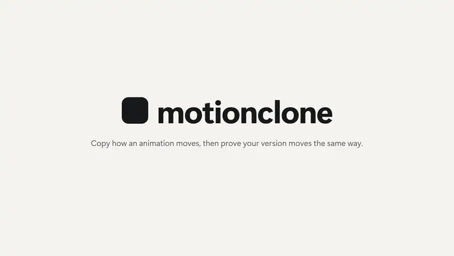
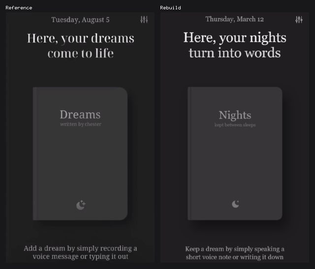

<h1 align="center">motionclone</h1>

<p align="center">
  <b>Copy how an animation moves, then prove your version moves the same way.</b>
  <br>
  Works from a live page, a local HTML file, or a screen recording or video (.mp4, .mov, .webm, .gif).
</p>

<p align="center">
  <a href="https://code.claude.com/docs/en/skills"></a>
  <a href="#install"></a>
  
  <a href="LICENSE"></a>
</p>

<p align="center">
  <a href=".github/assets/demo.mp4"></a>
  <br>
  <sub><a href=".github/assets/demo.mp4">Watch the full video</a></sub>
</p>

AI coding agents can copy a layout from a screenshot, but a screenshot has no motion.
So they guess the timing, use a generic ease-in-out, and stop after one pass.

motionclone measures the original as numbers: when each element starts and stops, how far it moves, its easing curve, overshoot, blur and opacity.
It records your rebuild the same way and checks it row by row.
Each row that is off names the element, the number and the direction.
Your agent fixes those rows and checks again, until every row matches.

<p align="center">
  
  <br>
  <sub>Left: a phone recording of Amie. Right: a rebuild with its own code, checked against the numbers from the recording.</sub>
</p>

## Install

You need Node 24 or later and pnpm.
motionclone is not on npm yet, so install it from source:

```sh
git clone https://github.com/codename-zen/motionclone
cd motionclone
pnpm install
pnpm exec playwright install chromium
pnpm build
npm link
```

This puts the `motionclone` command on your PATH.

Install the skill into Claude Code:

```sh
cp -r skill ~/.claude/skills/motionclone
```

Add the MCP server, so the agent can call the tools directly:

```sh
claude mcp add motionclone -- motionclone mcp
```

The skill works with either the CLI or the MCP server.
Then ask your agent, for example:

```text
Make the cards on https://example.com fade up like they do there, in src/components/CardGrid.tsx.
Copy the hover effect of the pricing buttons on https://example.com and check that it matches.
Here is a screen recording, recording.mp4. Rebuild the sheet that slides up in it.
Match the page-load animation of https://example.com and also make it look close. Show me a side by side.
```

## How it works

1. **Probe.** For a recording, motionclone finds the screen in the video, suggests a crop and scale, and lists the time windows with motion.
2. **Capture.** It records the reference in Chromium on a virtual clock, so two recordings of the same page are identical. From a page it reads every tracked element on every frame; from a video it follows elements by their pixels.
3. **Spec.** It turns the recording into rows, one per element and property: start, duration, easing, distance and overshoot. It uses the page's own CSS or WAAPI values when they match what was recorded, and fits a curve otherwise.
4. **Build.** The agent writes the motion in your project's own stack, with the spec numbers. It never copies fonts, images or code from the reference.
5. **Verify.** The rebuild is recorded with the same settings, and every row is checked. Each failing row comes with an image of the reference, the rebuild and their difference.
6. **Repeat.** The agent fixes only the rows that fail and verifies again. After five rounds it stops and tells you what still differs, instead of widening the tolerances.

Without an agent, the same steps are CLI commands:

```sh
motionclone capture https://example.com --out ref --duration 1500 --track ".hero h1, .card"
motionclone spec ref
motionclone capture http://localhost:5173 --like ref --out mine
motionclone verify ref mine
motionclone side-by-side ref mine --out compare.gif --labels "Reference,Rebuild"
```

`verify` exits with 0 when every row matches and 1 when a row is off.
The [guide](docs/guide.md) covers video input, hover, click, scroll and drag triggers, cookie banners and pages behind a login.

| What you ask for                                  | Level              | What must match                                                                                                                                                                                                     |
| ------------------------------------------------- | ------------------ | ------------------------------------------------------------------------------------------------------------------------------------------------------------------------------------------------------------------- |
| "Make it move like this"                          | `motion` (default) | Start, end and duration within 80 ms, stagger within 40 ms, easing curve within 0.05, distance within 10 %, overshoot within 5 points. The page keeps its own look.                                                 |
| "Make it look the same", "show them side by side" | `look`             | All of the above, plus colours (ΔE 6, background ΔE 3), type sizes (8 %), the position of large blocks (3 % of the screen) and a structure score on blurred still frames (0.9). Your own words and images are fine. |
| "Match it pixel for pixel"                        | `pixel`            | All of `look`, plus still frames that differ by 2 % of pixels or less. Only between two page captures, not against a video.                                                                                         |

Set the level with `motionclone verify ... --fidelity look`.

## Benchmarks

Real app recordings, measured from the video and rebuilt with new code.


|                    |                                                                                                                                        |
| ------------------ | -------------------------------------------------------------------------------------------------------------------------------------- |
| What it is         | Google Pay scratch card, from a phone screen recording.                                                                                |
| How it was rebuilt | A page with its own look, plus a second rebuild where the backdrop dims with the wrong timing.                                         |
| What was measured  | The card growing from the grid, the card moving to the centre, and the backdrop dimming. The second rebuild fails on the backdrop row. |


|                    |                                                                                                                                                                                                                          |
| ------------------ | ------------------------------------------------------------------------------------------------------------------------------------------------------------------------------------------------------------------------ |
| What it is         | Amie on iPhone: a black strip between the calendar and the todo list, dragged between three stops. A 9.4 s recording at 57 fps, read at 388 x 828 CSS px.                                                                |
| How it was rebuilt | HTML and JavaScript: a drag with three stops and a spring, and a slide off the edge. The finger path is replayed as pointer events.                                                                                      |
| What was measured  | The strip's position and its edges while it is dragged, the lunch event on the calendar, and the look: colours, type sizes and structure. The strip turning into a floating pill is not measured and was matched by eye. |


|                    |                                                                                                                                                                                      |
| ------------------ | ------------------------------------------------------------------------------------------------------------------------------------------------------------------------------------ |
| What it is         | Typefully on desktop: an info panel, a toolbar, the editor and a comments column that slide when the sidebars open and close. A 6.7 s recording at 60 fps, read at 866 x 464 CSS px. |
| How it was rebuilt | HTML and CSS transitions with ease-out curves of about 180 to 260 ms. The info panel is a reveal: its edge sweeps in while its content stays in place.                               |
| What was measured  | The editor's edge over four slides, the toolbar and info panel positions, and the look: colours, type sizes and structure.                                                           |



|                    |                                                                                                                                                                                                                   |
| ------------------ | ----------------------------------------------------------------------------------------------------------------------------------------------------------------------------------------------------------------- |
| What it is         | A dark dream journal on a phone screen. The closed book opens into a spread, three pages flip, it closes, then it is dragged twice and springs back. The whole 9 s recording.                                     |
| How it was rebuilt | One HTML page with a Web Animations timeline on the recording's clock. The book is a CSS 3D object; the pages peel with clip-path and transforms.                                                                 |
| What was measured  | The look: colours, type sizes, blocks and structure. The open, the flips and the close are rotation, which motionclone does not track yet, and the drags end where they start; these were matched frame by frame. |

Clips of Google Pay, Amie, Typefully and Yume belong to their owners and are shown only to compare the motion.

## Limits

- From a video, motionclone measures position, uniform scale, blur and opacity. Rotation, non-uniform scale and perspective are not measured, so a swinging or tilting element is lost.
- A motion where an element turns into another shape, such as a strip that becomes a floating pill, is not measured.
- Colour, shadow, clip-path and the content inside an element (text, images) are not measured as motion. From a video, fades and colour switches of a region or the background get progress rows; other colour-only changes do not.
- Canvas, WebGL and WebGPU drawing is not measured yet.
- A `steps()` animation that loops cannot be fitted yet.
- When an element is invisible at the start of its motion, its start value and exact easing are a best guess, and only the visible part is checked.
- Rows with weak evidence are shown as advisory and never fail.
- Timing passes within 80 ms by default, so a smaller difference in start, end or duration is not reported.
- A panel edge is found only where it stands out from what is around it.
- CI runs on Linux, and Windows is tested locally. macOS is not tested.

More limits are in the [guide](docs/guide.md#limits), and the design decisions are in [docs/adr](docs/adr).

## Repository

<details>
<summary>Main folders and files</summary>

| Path                       | What it holds                                                                                    |
| -------------------------- | ------------------------------------------------------------------------------------------------ |
| `src/capture`              | Page recording in Chromium on a virtual clock: triggers, frames and element tracks.              |
| `src/video`                | Video and gif input: finding the screen, regions, tracking, scale and blur.                      |
| `src/spec`                 | Turns a capture into spec rows, and the spec schema.                                             |
| `src/fit`                  | Easing fits: cubic bezier, spring and steps.                                                     |
| `src/measure`, `src/pixel` | Element readings from the page, and readings from pixels such as panel edges and fades.          |
| `src/verify`               | Pairs the rebuild's motions with the spec rows and checks each row, the look and the guardrails. |
| `src/look`                 | Design facts: palette, text colour, type sizes, radii and blocks.                                |
| `src/report`               | The report text and the failure images.                                                          |
| `src/media`                | Side by side GIF and MP4, design sheets and encoding.                                            |
| `src/cli`, `src/cli.ts`    | The `motionclone` command.                                                                       |
| `src/mcp.ts`               | The MCP server and its tools.                                                                    |
| `skill/`                   | The agent skill (`SKILL.md`).                                                                    |
| `docs/`                    | The [guide](docs/guide.md), [CI](docs/ci.md) and design decisions in `adr/`.                     |
| `fixtures/`                | Test pages whose animation values are known.                                                     |
| `test/`                    | Vitest tests, run against the fixtures.                                                          |

Run `pnpm test`, `pnpm lint` and `pnpm build` before you send a change.

</details>

## License

[MIT](LICENSE), codename-zen.
