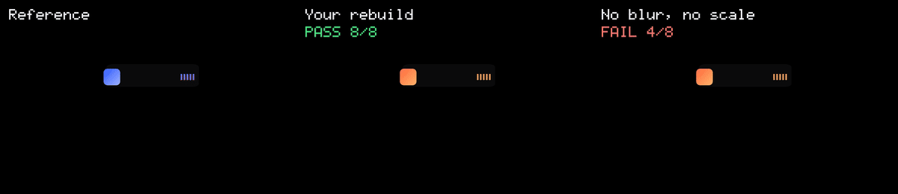
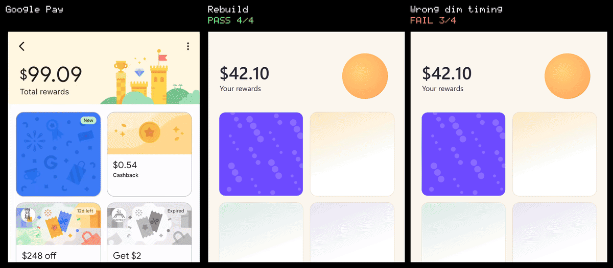
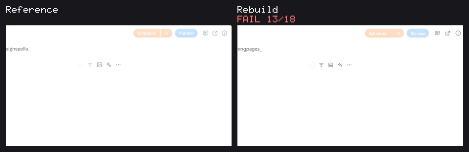
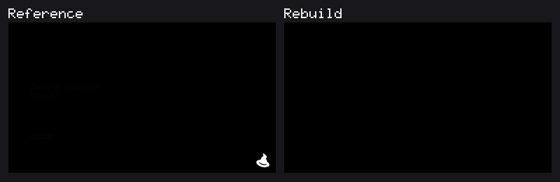

# motionclone

Copy how an animation moves, then prove your version moves the same way.

motionclone records an animation from a web page or a video and measures it frame by frame.
Then it records your version and tells you what is off, in numbers:

```text
- .art[0] blur missing: want 24 px -> 0 px from 450 ms over 320 ms, the clone never blurs
- .card[2] opacity starts 120 ms late (want 380, got 500)
```



Same motion with your own look passes. Leave out blur and scale and it fails on exactly those rows.

## Why

AI coding agents can copy a layout from a screenshot, but they cannot see motion.
They guess the timing, use a generic ease-in-out and call it done.
motionclone gives you and your agent the real numbers, and a check that fails until the motion matches.

## Benchmarks

Real app recordings, measured automatically and rebuilt with a different look.








Clips of Google Pay, Amie, Typefully and Vercel belong to their owners and are shown only to compare the motion.

## Install

You need Node 24 or later.
motionclone is not on npm yet, so install it from source:

```sh
git clone https://github.com/codename-zen/motionclone
cd motionclone
pnpm install
pnpm exec playwright install chromium
pnpm build
npm link
```

## Use it

```sh
# 1. Record the animation you like
motionclone capture https://example.com --out ref --duration 1500 --track ".hero h1, .card"

# 2. Turn it into a spec
motionclone spec ref

# 3. Build your version, then record it the same way
motionclone capture http://localhost:5173 --like ref --out mine

# 4. Compare
motionclone verify ref mine

# 5. Show both side by side
motionclone side-by-side ref mine --out compare.gif --labels "Reference,Rebuild"
```

`verify` exits with 0 when every row matches and 1 when something is off.
It also saves images of the failing moments, with the reference and your version side by side.
`side-by-side` makes a labelled GIF or MP4 of whole captures, with the verify result under each label.

The reference can also be a screen recording or a gif.
See the [guide](docs/guide.md) for video, triggers like hover and scroll, cookie banners and logged-in pages.

## With an AI agent

Add the MCP server to your agent, for example Claude Code:

```sh
claude mcp add motionclone -- motionclone mcp
```

Then copy the [`skill`](skill) folder to your agent's skills folder (`~/.claude/skills/motionclone` for Claude Code).
The skill tells the agent to record, build, verify and fix until every row passes, and to stop after five rounds and say what still differs.

## What it measures

- When each element starts and stops moving, and the gap between siblings.
- The easing curve, including springs and overshoot.
- Opacity, position, scale, rotation, size and blur.
- Elements that should stay still.

It does not measure colour, shadow, or what is drawn inside an element (text, images, canvas).
The report lists what it did not check, and warns when the reference changes somewhere you did not measure.
More limits are in the [guide](docs/guide.md#limits).

## Use what you may

motionclone copies numbers about motion, not fonts, images or code.
What you build with those numbers should be your own.

## Development

```sh
pnpm test
pnpm lint
pnpm build
```

The tests run against pages in `fixtures` whose animation values are known.
CI runs on a self-hosted Linux runner, see [docs/ci.md](docs/ci.md).

## License

[MIT](LICENSE)
